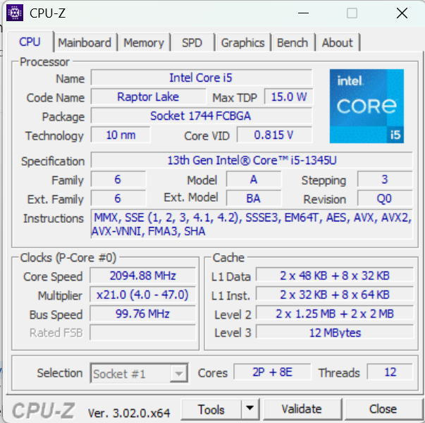
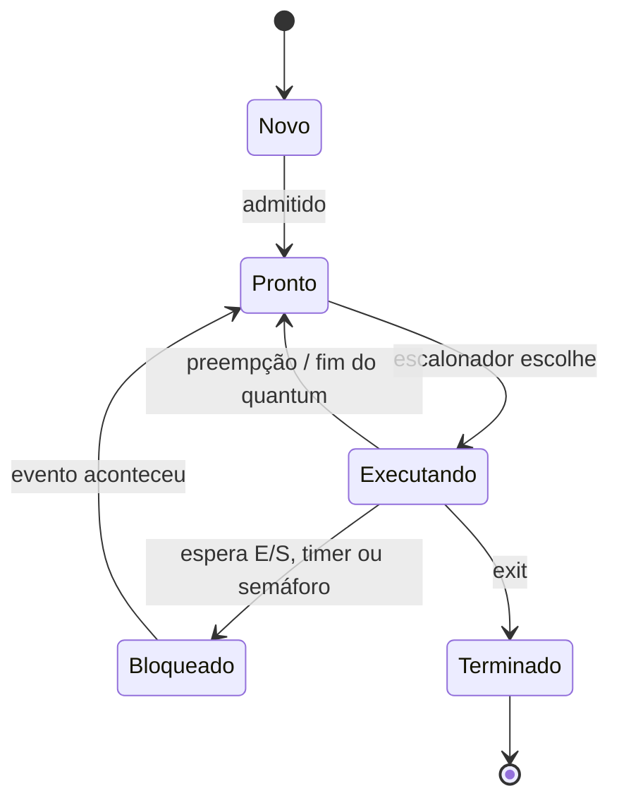
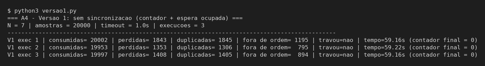
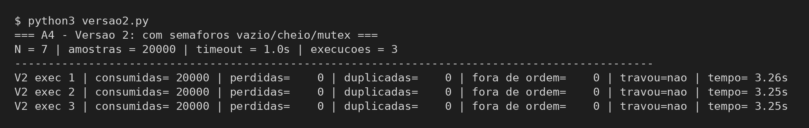
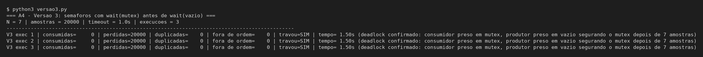
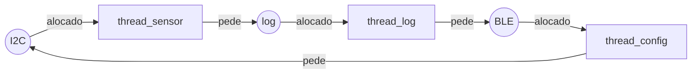

**Raiane Araujo Brandão | D1 = 6 | D2 = 9 | N = 7**

# Ponderada CC08: do pipeline ao deadlock (Tato)

## Parâmetros individuais

Contagem das letras do nome completo, incluindo acentos:

| Nome | Letras |
|---|---|
| Raiane | R-a-i-a-n-e = 6 |
| Araujo | A-r-a-u-j-o = 6 |
| Brandão | B-r-a-n-d-ã-o = 7 |
| **Total** | 6 + 6 + 7 = **19** |

- **D1** = letras do primeiro nome = **6** (menor que 10, então não é preciso pegar só o último dígito)
- **D2** = último dígito de 19 = **9**

Com isso, os parâmetros da tabela ficam:

| Parâmetro | Fórmula | Conta | Valor |
|---|---|---|---|
| IC (instruções por amostra) | 100.000 + 20.000 × D2 | 100.000 + 20.000 × 9 = 100.000 + 180.000 | **280.000 instruções** |
| m (taxa de falta na L1) | 3% + 0,5% × D1 | 3% + 0,5% × 6 = 3% + 3% | **6% = 0,06** |
| N (tamanho do buffer) | 3 + (D2 mod 5) | 9 mod 5 = 4 → 3 + 4 | **7 posições** |

O requisito principal do produto é que **cada amostra seja processada em no máximo 5 ms**, sendo que chega uma amostra a cada 10 ms.

---

# Parte A: o problema técnico

## A1. Arquitetura e memória: qual processador vai na pulseira?

### A1.1 Plataforma H (Harvard, 48 MHz, CPI 1,5)

Tempo de CPU:

$$T = \frac{IC \times CPI}{f}$$

Ciclos totais:

$$\text{ciclos} = IC \times CPI = 280.000 \times 1{,}5 = 420.000 \text{ ciclos}$$

Dividindo pelo clock (48 MHz = 48.000.000 ciclos por segundo):

$$T_H = \frac{420.000}{48.000.000} = 0{,}00875 \text{ s} = \mathbf{8{,}75 \text{ ms}}$$

**Atende os 5 ms? Não.** O tempo fica 3,75 ms acima do limite (75% a mais). Ele cabe no período de 10 ms entre amostras, mas o requisito é de 5 ms, então o aviso de obstáculo chegaria atrasado.

### A1.2 Plataforma V (Von Neumann, 1,2 GHz, cache L1)

**AMAT (tempo médio de acesso à memória):**

$$AMAT = t_{acerto} + m \times \text{penalidade}$$

$$AMAT = 1 + 0{,}06 \times 120 = 1 + 7{,}2 = \mathbf{8{,}2 \text{ ciclos}}$$

Em tempo, isso equivale a 8,2 / 1,2 GHz = 8,2 × 0,833 ns ≈ 6,83 ns por acesso.

**CPI efetivo** (fórmula do enunciado):

$$CPI_{ef} = 1{,}0 + (\text{acessos por instrução} \times m \times \text{penalidade})$$

Calculando primeiro as paradas por instrução:

$$1{,}3 \times 0{,}06 = 0{,}078 \text{ faltas por instrução}$$
$$0{,}078 \times 120 = 9{,}36 \text{ ciclos de parada por instrução}$$

Logo:

$$CPI_{ef} = 1{,}0 + 9{,}36 = \mathbf{10{,}36}$$

O mesmo valor sai a partir do AMAT: cada acesso custa 7,2 ciclos a mais que um acerto, então 1 + 1,3 × 7,2 = 1 + 9,36 = 10,36.

Ou seja, por causa das faltas na cache, o CPI real é mais de 10 vezes o CPI nominal de 1,0.

**Tempo médio por amostra:**

$$\text{ciclos} = 280.000 \times 10{,}36 = 2.900.800 \text{ ciclos}$$

$$T_V = \frac{2.900.800}{1.200.000.000} = 0{,}0024173 \text{ s} \approx \mathbf{2{,}42 \text{ ms}}$$

**Pior caso** (somando o atraso do Linux):

$$T_{V,pior} = 2{,}42 + 3{,}00 = \mathbf{5{,}42 \text{ ms}}$$

**Atende os 5 ms?** Na média sim, mas no pior caso não: ultrapassa o limite em 0,42 ms. Como o requisito vale para cada amostra, e não para a média, a Plataforma V **não atende** nessas condições. O que causa a violação não é o processamento em si, e sim o atraso de até 3 ms que o sistema operacional pode introduzir.

### A1.3 Plataforma H com acelerador DSP (Lei de Amdahl)

Dados: fração melhorada F = 0,6 (o filtro corresponde a 60% do tempo) e ganho na parte melhorada S = 5.

$$Speedup_{global} = \frac{1}{(1 - F) + \frac{F}{S}}$$

$$Speedup = \frac{1}{(1 - 0{,}6) + \frac{0{,}6}{5}} = \frac{1}{0{,}4 + 0{,}12} = \frac{1}{0{,}52} \approx \mathbf{1{,}923}$$

Novo tempo:

$$T_{H+DSP} = \frac{8{,}75}{1{,}923} = 8{,}75 \times 0{,}52 = \mathbf{4{,}55 \text{ ms}}$$

Conferindo por partes: a parte não acelerada continua com 0,4 × 8,75 = 3,50 ms, e o filtro passa a levar 0,6 × 8,75 / 5 = 5,25 / 5 = 1,05 ms. Total: 3,50 + 1,05 = 4,55 ms.

**Agora atende? Sim**, com folga de 5 − 4,55 = **0,45 ms** (cerca de 9%). Como a H não tem sistema operacional, não existe preempção pelo escalonador, o que torna o tempo mais previsível do que na V. Isso não significa que 4,55 ms seja o pior caso garantido: o firmware ainda trata interrupções (timer, BLE, I2C) e faz acessos a periféricos que podem bloquear. O pior caso real precisa incluir esses tempos, e por isso a folga de 0,45 ms deve ser confirmada com medições na placa.

Vale notar também que, mesmo com um DSP infinitamente rápido, o speedup máximo seria 1 / 0,4 = 2,5 (tempo mínimo de 3,5 ms), porque os 40% que não são filtro continuam iguais.

### A1.4 Por que a V precisa de cache e a H não?

Na arquitetura Von Neumann, instruções e dados compartilham o mesmo barramento e a mesma memória. Na V, essa memória é uma DRAM externa com penalidade de 120 ciclos, ligada a uma CPU de 1,2 GHz, de modo que sem cache o processador passaria a maior parte do tempo esperando a memória: esse é o gargalo de Von Neumann. A cache mantém perto da CPU os dados e instruções usados recentemente e faz a maioria dos acessos custar 1 ciclo; mesmo assim, com 6% de falta, o CPI efetivo já chega a 10,36. Na H, que é Harvard, instruções e dados têm caminhos separados, e a SRAM interna responde em 1 ciclo a um clock de 48 MHz, então a memória acompanha a velocidade da CPU e não há gargalo a compensar.

### A1.5 Evidência da minha máquina



Meu notebook tem um **Intel Core i5-1345U** (13ª geração, Raptor Lake), com 2 núcleos de desempenho (P) e 8 de eficiência (E). Na aba *Caches* do CPU-Z (e no resumo da aba CPU) aparece:

| Nível | Tamanho |
|---|---|
| L1 Data | 2 × 48 KB + 8 × 32 KB |
| L1 Inst. | 2 × 32 KB + 8 × 64 KB |
| Level 2 | 2 × 1,25 MB + 2 × 2 MB |
| Level 3 | 12 MB |

**A L1 é dividida em instruções e dados?** Sim. O CPU-Z mostra a L1 em duas linhas, "L1 Data" e "L1 Inst.", e cada núcleo tem uma de cada (daí a notação "2 × ... + 8 × ...", referente aos 10 núcleos). A L2 e a L3 aparecem em uma linha cada, sem separação entre instruções e dados, e a memória principal também é única.

**Então é Von Neumann ou Harvard?** É uma arquitetura **Harvard modificada**. Do ponto de vista do programa e do sistema operacional, o computador é **Von Neumann**: existe uma única memória principal, com um único espaço de endereçamento para código e dados (tanto que um programa pode ser carregado como dado e depois executado). Já no nível da L1, a separação entre cache de instruções e cache de dados permite buscar uma instrução e acessar um dado no mesmo ciclo, que é a característica da arquitetura Harvard. Essa combinação reduz o gargalo de Von Neumann sem abrir mão da memória unificada.

---

## A2. Pipeline: o loop do filtro

```asm
1  lw   x5, 0(x10)     # lê a amostra nova
2  add  x6, x6, x5     # soma += nova
3  lw   x7, 0(x11)     # lê a amostra mais antiga
4  sub  x6, x6, x7     # soma -= antiga
5  sw   x6, 0(x12)     # grava a soma
6  addi x10, x10, 4    # avança o ponteiro da nova
7  addi x11, x11, 4    # avança o ponteiro da antiga
```

### A2.1 Dependências RAW (leitura após escrita)

| Quem depende | De quem | Registrador | Tipo |
|---|---|---|---|
| I2 (add) | I1 (lw) | x5 | load-use |
| I4 (sub) | I2 (add) | x6 | ALU → ALU |
| I4 (sub) | I3 (lw) | x7 | load-use |
| I5 (sw) | I4 (sub) | x6 | ALU → store |

Também há I6 escrevendo x10 depois que I1 o lê, e I7 escrevendo x11 depois que I3 o lê. Essas são dependências **WAR** (escrita após leitura), não RAW, e não causam conflito em um pipeline de 5 estágios em ordem.

### A2.2 Sem forwarding

Como o banco de registradores é escrito na primeira metade do ciclo e lido na segunda, a instrução dependente pode fazer ID no mesmo ciclo do WB da instrução produtora. Se a produtora faz IF no ciclo t, seu WB ocorre em t+4, e a dependente só pode fazer ID a partir de t+4. Sem conflito, ela faria ID em t+2, então cada dependência entre instruções vizinhas gera **2 bolhas**.

Legenda: `ID*` / `IF*` = instrução parada repetindo o estágio (bolha).

| Instr. | 1 | 2 | 3 | 4 | 5 | 6 | 7 | 8 | 9 | 10 | 11 | 12 | 13 | 14 | 15 | 16 | 17 |
|---|---|---|---|---|---|---|---|---|---|---|---|---|---|---|---|---|---|
| I1 lw x5 | IF | ID | EX | MEM | WB | | | | | | | | | | | | |
| I2 add x6 | | IF | ID | ID* | ID* | EX | MEM | WB | | | | | | | | | |
| I3 lw x7 | | | IF | IF* | IF* | ID | EX | MEM | WB | | | | | | | | |
| I4 sub x6 | | | | | | IF | ID | ID* | ID* | EX | MEM | WB | | | | | |
| I5 sw x6 | | | | | | | IF | IF* | IF* | ID | ID* | ID* | EX | MEM | WB | | |
| I6 addi x10 | | | | | | | | | | IF | IF* | IF* | ID | EX | MEM | WB | |
| I7 addi x11 | | | | | | | | | | | | | IF | ID | EX | MEM | WB |

Paradas:
- I2 precisa de x5: I1 faz WB no ciclo 5, então I2 só lê o registrador no ID do ciclo 5 (2 bolhas).
- I4 precisa de x7 (WB de I3 no ciclo 9) e de x6 (WB de I2 no ciclo 8). Prevalece a dependência que termina mais tarde, e o ID fica no ciclo 9 (2 bolhas).
- I5 precisa de x6 de I4 (WB no ciclo 12), então faz ID no ciclo 12 (2 bolhas).

Sem nenhum conflito, o trecho levaria 5 + (7 − 1) = 11 ciclos. São **4 relações RAW, mas apenas 3 esperas**: I4 depende de I2 e de I3 ao mesmo tempo, e as duas esperas se sobrepõem. O x6 fica disponível no ciclo 8, mas I4 precisa aguardar até o ciclo 9 por causa do x7, então a espera de I2 → I4 é absorvida pela de I3 → I4 e não deve ser somada separadamente. Com 3 esperas de 2 bolhas cada, são 6 bolhas:

$$11 + 6 = \mathbf{17 \text{ ciclos}}$$ (do primeiro IF no ciclo 1 ao último WB no ciclo 17)

### A2.3 Com forwarding

Com forwarding, o resultado de uma operação da ALU fica disponível no fim do EX e pode ser repassado ao EX da instrução seguinte sem bolha. O `lw`, porém, só obtém o dado no **fim do MEM**, então a instrução imediatamente posterior a um load ainda precisa de **1 bolha** (load-use).

| Instr. | 1 | 2 | 3 | 4 | 5 | 6 | 7 | 8 | 9 | 10 | 11 | 12 | 13 |
|---|---|---|---|---|---|---|---|---|---|---|---|---|---|
| I1 lw x5 | IF | ID | EX | MEM | WB | | | | | | | | |
| I2 add x6 | | IF | ID | ID* | EX | MEM | WB | | | | | | |
| I3 lw x7 | | | IF | IF* | ID | EX | MEM | WB | | | | | |
| I4 sub x6 | | | | | IF | ID | ID* | EX | MEM | WB | | | |
| I5 sw x6 | | | | | | IF | IF* | ID | EX | MEM | WB | | |
| I6 addi x10 | | | | | | | | IF | ID | EX | MEM | WB | |
| I7 addi x11 | | | | | | | | | IF | ID | EX | MEM | WB |

- I1 → I2 (x5): o dado sai do MEM no ciclo 4 e é encaminhado ao EX de I2 no ciclo 5 (MEM/WB → EX). 1 bolha.
- I3 → I4 (x7): mesmo caso, MEM no ciclo 7 e EX de I4 no ciclo 8. 1 bolha.
- I2 → I4 (x6): sem bolha, pois I2 já escreveu o registrador no ciclo 7, quando I4 está no ID.
- I4 → I5 (x6): sem bolha, com forwarding EX/MEM → EX.

$$11 + 2 = \mathbf{13 \text{ ciclos}}$$

**Qual dependência continua causando bolha, e por quê?** As duas dependências **load-use**: I1 → I2 (x5) e I3 → I4 (x7). O forwarding só encaminha um valor que já foi produzido. O `lw` só tem o dado no fim do MEM, e a instrução seguinte precisaria dele no início do EX, no mesmo ciclo. Como o dado ainda não existe nesse momento, pelo menos 1 ciclo de espera é inevitável.

### A2.4 Reordenação para eliminar as bolhas

Para eliminar as bolhas, basta haver uma instrução independente entre cada `lw` e a instrução que usa o valor carregado. Subir o segundo `lw` para logo depois do primeiro resolve os dois casos:

```asm
1  lw   x5, 0(x10)     # lê a nova
3  lw   x7, 0(x11)     # lê a antiga   (subiu)
2  add  x6, x6, x5     # x5 ficou 2 instruções depois do load
4  sub  x6, x6, x7     # x7 ficou 2 instruções depois do load
5  sw   x6, 0(x12)
6  addi x10, x10, 4
7  addi x11, x11, 4
```

O resultado é o mesmo porque os dois loads usam x10 e x11 antes de qualquer `addi` alterar esses ponteiros, I3 não lê nem escreve registradores usados por I2 (x7 de um lado, x5/x6 do outro) e a operação soma + nova − antiga continua na mesma ordem. Os `addi` permanecem no fim, então todos os endereços são os mesmos.

| Instr. | 1 | 2 | 3 | 4 | 5 | 6 | 7 | 8 | 9 | 10 | 11 |
|---|---|---|---|---|---|---|---|---|---|---|---|
| lw x5 | IF | ID | EX | MEM | WB | | | | | | |
| lw x7 | | IF | ID | EX | MEM | WB | | | | | |
| add x6 | | | IF | ID | EX | MEM | WB | | | | |
| sub x6 | | | | IF | ID | EX | MEM | WB | | | |
| sw x6 | | | | | IF | ID | EX | MEM | WB | | |
| addi x10 | | | | | | IF | ID | EX | MEM | WB | |
| addi x11 | | | | | | | IF | ID | EX | MEM | WB |

- x5: MEM do lw no ciclo 4 → EX do add no ciclo 5 (MEM/WB → EX). Sem bolha.
- x7: MEM do lw no ciclo 5 → EX do sub no ciclo 6 (MEM/WB → EX). Sem bolha.
- x6 (add → sub e sub → sw): EX/MEM → EX. Sem bolha. Aqui assumo, como nas outras tabelas com forwarding, que o `sw` também recebe por forwarding o dado a ser gravado (x6), e não apenas os operandos da ALU. Sem esse caminho, I4 → I5 geraria bolha.

$$5 + (7 - 1) + 0 = \mathbf{11 \text{ ciclos}}$$

Com a reordenação, o trecho passa de 13 para 11 ciclos sem nenhuma mudança de hardware.

---

## A3. Processos e threads: como organizar o software

### A3.1 Organização proposta

| Tarefa | Vira | Onde |
|---|---|---|
| Ler o sensor | thread | **Processo 1 (tempo real)** |
| Processar a amostra | thread | Processo 1 |
| Acionar o motor | thread | Processo 1 |
| BLE (log + comandos) | processo separado | **Processo 2 (comunicação)** |

Justificativa:
- **Compartilhamento de memória:** sensor → processamento → motor formam um único fluxo, executado 100 vezes por segundo, em que a amostra passa de uma etapa para a outra pelo buffer. Como threads do mesmo processo, elas acessam o mesmo buffer diretamente, sem cópia e sem chamadas ao kernel. O BLE não precisa desse acesso: ele envia o log e recebe configurações de forma esporádica, então pode se comunicar por IPC (pipe, socket local ou fila de mensagens) sem comprometer o prazo.
- **Custo de criação e troca de contexto:** threads do mesmo processo também passam por troca de contexto. A diferença é que criar threads e alternar entre elas é mais barato, porque o espaço de endereçamento não muda e a TLB não precisa ser invalidada. O ganho maior, porém, está na comunicação, já que passar a amostra adiante é apenas uma escrita em memória. A troca para o processo BLE é mais cara, mas acontece com pouca frequência e fora do caminho crítico.
- **Isolamento de falhas:** se o BLE falhar, apenas o seu processo é encerrado, e o processo de tempo real continua acionando o motor. Se ele fosse uma thread, um erro de memória no BLE derrubaria o processo inteiro, e a pessoa ficaria sem aviso de obstáculos.

O isolamento por processo protege a memória, mas não todos os recursos: um BLE em loop ainda pode consumir CPU, e um volume grande de mensagens pode encher a fila de IPC. Por isso, o processo 1 roda com prioridade de tempo real (SCHED_FIFO) e o BLE com prioridade normal e limite de CPU (cgroups), para que o BLE não tire tempo de processamento do sensor.

### A3.2 BLE explorado: thread ou processo faz diferença?

Faz diferença. O BLE é o único componente que **recebe dados externos** (qualquer dispositivo próximo pode enviar pacotes), então é o ponto de entrada mais provável de um ataque.

- **Como thread:** o BLE compartilha o espaço de endereçamento com o sensor, o filtro e o motor. Explorando, por exemplo, um buffer overflow no BLE, um atacante poderia ler e alterar toda essa memória: desligar a vibração, mudar a distância de alerta ou falsificar amostras. Para uma pessoa com deficiência visual, isso representa risco físico.
- **Como processo:** o atacante fica restrito ao espaço de endereçamento do processo BLE. Para afetar o motor, ele precisaria passar pela interface de IPC, que aceita apenas mensagens em formato definido e pode validá-las (limites de distância, tipos de comando permitidos). Além disso, o processo BLE pode rodar com um usuário sem privilégios, sem acesso ao I2C e com sandbox (seccomp). Nesse caso, o pior efeito direto de uma exploração passa a ser a perda do BLE, e não o controle da pulseira, ressalvadas as limitações de recursos citadas em A3.1.

### A3.3 Diagrama de estados de um processo



(Em texto, caso o mermaid não seja renderizado: Novo → Pronto → Executando; Executando → Pronto na preempção; Executando → Bloqueado ao aguardar um evento; Bloqueado → Pronto quando o evento ocorre; Executando → Terminado ao final.)

**Em qual estado a thread do sensor passa a maior parte do tempo? Bloqueada.** Ela só tem trabalho uma vez a cada 10 ms: é acordada pelo timer, solicita a leitura pelo I2C (e volta a bloquear enquanto espera o barramento), coloca a amostra no buffer e aguarda o próximo período. A leitura do sensor leva bem menos que 10 ms, e o processamento (2,42 ms na V) é feito por outra thread. Pelas premissas do enunciado, portanto, a thread do sensor passa a maior parte de cada período bloqueada, esperando o timer ou o hardware. A proporção exata é uma estimativa e só poderia ser confirmada com medição na placa (por exemplo, com tracing do kernel).

---

## A4. Código com semáforos: o buffer entre o sensor e o motor

Código em `codigo/` (Python 3 com `threading`), N = 7, 20.000 amostras e timeout de 1 s:
- `codigo/versao1.py`: sem sincronização (contador compartilhado, espera ocupada e `time.sleep(0)` entre a leitura e a escrita do contador).
- `codigo/versao2.py`: semáforos `vazio` (N), `cheio` (0) e `mutex` (1).
- `codigo/versao3.py`: igual à versão 2, mas o produtor faz `wait(mutex)` antes de `wait(vazio)`.
- `codigo/comum.py`: parâmetros e contagem de amostras consumidas, perdidas, duplicadas e fora de ordem.

Cada script executa as 3 rodadas (`python3 versaoX.py`).

Critérios de contagem: **consumidas** = número de leituras feitas pelo consumidor; **perdidas** = 20.000 − amostras distintas recebidas; **duplicadas** = consumidas − amostras distintas; **fora de ordem** = número de transições em que uma amostra válida tem número menor que a amostra válida anterior (conta inversões entre leituras consecutivas, não quantas amostras estão em posição errada). Na versão 1, o consumidor pode ler uma posição do buffer que ainda não foi preenchida (`None`); essa leitura conta como consumida, mas não como amostra distinta, e é ignorada na comparação de ordem. Esta última métrica identifica um problema que as outras não captam: o motor pode receber todas as amostras, sem perdas nem repetições, mas em ordem errada, o que faria a vibração usar uma distância antiga depois de uma mais recente.

### Tabela de resultados

| Versão | Execução | Consumidas | Perdidas | Duplicadas | Fora de ordem | Travou? |
|---|---|---|---|---|---|---|
| 1 (sem sincronização) | 1 | 20.002 | 1.843 | 1.845 | 1.195 | não |
| 1 (sem sincronização) | 2 | 19.953 | 1.353 | 1.306 | 795 | não |
| 1 (sem sincronização) | 3 | 19.997 | 1.408 | 1.405 | 894 | não |
| 2 (semáforos) | 1 | 20.000 | 0 | 0 | 0 | não |
| 2 (semáforos) | 2 | 20.000 | 0 | 0 | 0 | não |
| 2 (semáforos) | 3 | 20.000 | 0 | 0 | 0 | não |
| 3 (ordem trocada) | 1 | 0 | 20.000 | 0 | 0 | **sim** |
| 3 (ordem trocada) | 2 | 0 | 20.000 | 0 | 0 | **sim** |
| 3 (ordem trocada) | 3 | 0 | 20.000 | 0 | 0 | **sim** |

Conferência da execução 1 da versão 1: amostras distintas = 20.000 − 1.843 = 18.157; duplicadas = 20.002 − 18.157 = 1.845.

Quanto ao tempo, na minha máquina a versão 1 levou cerca de **59 s** por execução e a versão 2 cerca de **3,2 s**. A diferença reflete o custo da espera ocupada: a thread fica repetindo o `while` sem fazer trabalho útil e, em Python, mantém o GIL enquanto isso, atrasando a outra thread. Esse número, no entanto, não serve como medida geral de desempenho de semáforos, porque depende do GIL, do escalonador e do computador. Uma comparação conclusiva exigiria execuções controladas, nas mesmas condições e com mais repetições.

### Prints

Versão 1:



Versão 2:



Versão 3:



### Região crítica da versão 1 e por que ela perde ou duplica amostras

A região crítica é **todo o acesso ao estado compartilhado**: verificar o contador, escrever ou ler a posição do buffer, avançar o índice e atualizar o contador. Essas operações só são consistentes se executadas em conjunto, sem interferência da outra thread. O erro aparece principalmente na atualização do contador (`tmp = contador; sleep(0); contador = tmp ± 1`), que é uma operação de leitura, modificação e escrita em três passos; o `sleep(0)` entre eles permite que a outra thread execute justamente nesse intervalo. O resultado é a **atualização perdida**:

- **Duplicação:** o produtor lê `contador = 3` e é interrompido. O consumidor retira uma amostra e escreve `contador = 2`. O produtor volta e escreve `3 + 1 = 4`, apagando o decremento do consumidor. O contador indica 4 amostras quando há 3, e o consumidor acaba lendo uma posição que ainda não foi reescrita, recebendo **novamente uma amostra antiga**.
- **Perda:** o caso inverso. O consumidor lê `contador = 3` e é interrompido, o produtor escreve 4 e o consumidor escreve `3 − 1 = 2`. O contador passa a indicar menos amostras do que existem, e o produtor **sobrescreve uma amostra que ainda não foi lida**.

Os dois erros ocorrem em quantidades parecidas, o que explica as consumidas próximas de 20.000. Ainda assim, cada execução teve mais de mil amostras perdidas e mais de mil duplicadas (cerca de 6,5 a 9%), além de 800 a 1.200 inversões de ordem. Na pulseira, isso corresponde ao motor vibrando com distâncias antigas, fora de ordem ou com leituras faltando. Nenhuma das 3 execuções travou, o que é coerente com o código: para travar, o produtor precisaria estar esperando com `contador ≥ 7` e o consumidor com `contador ≤ 0` ao mesmo tempo, o que não é possível. Assim, o erro da versão 1 não interrompe o sistema; ele produz dados incorretos sem nenhum sinal de falha. Mesmo assim, o script tem um limite global de 300 s por execução, para que um estado não previsto da corrida não deixe o programa preso indefinidamente.

### O que cada semáforo garante na versão 2

- **vazio (começa em N = 7):** conta as posições livres. O produtor faz `wait(vazio)` antes de escrever, então **nunca escreve com o buffer cheio** e não sobrescreve amostras não lidas, eliminando as perdas.
- **cheio (começa em 0):** conta as amostras disponíveis. O consumidor faz `wait(cheio)` antes de ler, então **nunca lê com o buffer vazio** nem lê uma posição antiga, eliminando as duplicações. Além disso, ele fica bloqueado em vez de executar espera ocupada.
- **mutex (começa em 1):** garante **exclusão mútua** no acesso ao buffer e aos índices, de modo que a interrupção provocada pelo `sleep(0)` não causa mais inconsistência.

Nas 3 execuções, foram 20.000 consumidas, 0 perdidas, 0 duplicadas e 0 fora de ordem. A ordem é preservada porque, com o mutex e o buffer circular, o consumidor lê as posições na mesma sequência em que o produtor as escreveu.

### Versão 3: deadlock com a ordem trocada

As 3 execuções terminaram em **deadlock**, todas depois de **7 amostras** (= N). Nessas execuções, o produtor começou primeiro e preencheu o buffer; como ele libera e readquire o mutex muito rapidamente, conseguiu o mutex em todas as tentativas. Isso, porém, é um comportamento observado do escalonador, **não uma garantia do código**: se o consumidor obtiver o mutex antes (e o `sleep(0)` dá essa oportunidade), ele consome algumas amostras e o deadlock acontece mais tarde. O que o código garante é que, **sempre que o produtor tentar inserir com o buffer cheio**, haverá deadlock. Nas minhas execuções, na 8ª amostra:

1. o produtor faz `wait(mutex)` e obtém o mutex;
2. faz `wait(vazio)`, mas `vazio = 0` (buffer cheio), e **bloqueia mantendo o mutex**;
3. o consumidor faz `wait(cheio)` (há 7 amostras, então passa) e `wait(mutex)`, que está com o produtor, e **bloqueia**;
4. `vazio` só aumentaria se o consumidor lesse uma amostra, e o consumidor só pode ler se o produtor liberar o mutex. Nenhuma das duas condições pode ocorrer.

Após 1 s sem receber nada, o consumidor registrou o travamento. Como um timeout, sozinho, só mostra falta de progresso, o script confirma o deadlock antes de encerrar: verifica que a thread do produtor continua viva, que o número de amostras produzidas não mudou e que o mutex continua ocupado. Nas 3 execuções, as três condições foram verdadeiras. Por isso foram 0 consumidas: o consumidor não chegou a entrar na região crítica. A mesma questão aparece na A5: a ordem de aquisição dos recursos determina se o deadlock é possível. O semáforo de contagem, que pode bloquear por mais tempo, deve ser adquirido antes do mutex, que deve ficar retido pelo menor tempo possível.

---

## A5. Deadlock: a pulseira congelou

```
thread_sensor:     thread_log:      thread_config:
  P(i2c)             P(log)           P(ble)
  le_sensor()        le_log()         recebe_comando()
  P(log)             P(ble)           P(i2c)
  registra()         envia()          ajusta_sensor()
  V(log)             V(ble)           V(i2c)
  V(i2c)             V(log)           V(ble)
```

### A5.1 Sequência que leva ao deadlock e grafo

1. `thread_sensor` faz `P(i2c)`, obtém o I2C e começa `le_sensor()`.
2. Troca de contexto. `thread_log` faz `P(log)`, obtém o log e começa `le_log()`.
3. Troca de contexto. `thread_config` faz `P(ble)`, obtém o BLE e começa `recebe_comando()`.
4. `thread_sensor` termina a leitura e faz `P(log)`; o log está com `thread_log`, então ela **bloqueia**.
5. `thread_log` faz `P(ble)`; o BLE está com `thread_config`, então ela **bloqueia**.
6. `thread_config` faz `P(i2c)`; o I2C está com `thread_sensor`, então ela **bloqueia**.

Nenhuma thread chega ao `V`, e as três permanecem bloqueadas indefinidamente. Como a thread do sensor está entre elas, a pulseira para de vibrar até ser reiniciada.

Grafo de alocação de recursos nesse instante (seta recurso → thread = alocado; thread → recurso = solicitado):



Em texto: `I2C → sensor → log → thread_log → BLE → config → I2C`. O grafo tem um **ciclo** e cada recurso tem uma única instância, então o ciclo caracteriza deadlock.

### A5.2 As quatro condições no código

| Condição | Como aparece aqui |
|---|---|
| **Exclusão mútua** | i2c, log e ble são semáforos binários (iniciam em 1), então cada recurso é usado por uma thread de cada vez. Isso é necessário, já que duas threads não podem usar o barramento I2C simultaneamente. |
| **Posse e espera** | Cada thread mantém o primeiro recurso enquanto espera o segundo: o sensor mantém `i2c` e pede `log`, o log mantém `log` e pede `ble`, o config mantém `ble` e pede `i2c`. |
| **Sem preempção** | Um semáforo não pode ser retirado da thread que o adquiriu. Só ela pode executar o `V`, e ela está bloqueada no `P` seguinte. |
| **Espera circular** | sensor espera log → log espera config → config espera sensor. Cada thread adquire os recursos em uma ordem diferente (i2c→log, log→ble, ble→i2c), o que fecha o ciclo. |

### A5.3 Duas correções de tipos diferentes

**Correção 1: prevenção, eliminando a espera circular com uma ordem global.**
Define-se a ordem `i2c < log < ble`, e toda thread passa a adquirir recursos em ordem crescente. O sensor (i2c → log) e o log (log → ble) já seguem essa ordem; só a `thread_config` precisa mudar:

```
thread_config:
  P(i2c)
  P(ble)
  recebe_comando()
  ajusta_sensor()
  V(ble)
  V(i2c)
```

Outra opção é a `thread_config` não manter os dois recursos ao mesmo tempo: `P(ble); recebe_comando(); V(ble); P(i2c); ajusta_sensor(); V(i2c)`, o que elimina a condição de posse e espera. Com a ordem global, o ciclo não pode se formar e o deadlock deixa de ser possível.
**Para quem usa:** não há mudança perceptível, apenas a pulseira deixa de travar. O custo é que um comando de configuração pode demorar um pouco mais para ser aplicado, porque a `thread_config` precisa esperar o I2C ficar livre, o que deve ser da ordem de milissegundos.

**Correção 2: detecção e recuperação, com timeout e watchdog.**
O `P` é substituído por uma versão com tempo limite (`sem_timedwait`). Se uma thread não consegue o segundo recurso em, por exemplo, 20 ms, ela assume um possível deadlock, **libera o recurso que já tem** (`V`), espera um tempo aleatório e tenta novamente. Isso desfaz o ciclo sem reiniciar o sistema. Como segunda camada, há um **watchdog** de hardware: se a thread do sensor não sinalizar o watchdog dentro de um intervalo definido, a pulseira é reiniciada.
Essa estratégia exige cuidado com o que a thread **já executou** antes do timeout. Por exemplo, a `thread_sensor` pode ter lido o sensor e não ter conseguido o `log` para registrar. Se ela liberar o I2C e repetir tudo, fará uma nova leitura e a primeira será perdida (ou registrada duas vezes, se o registro já tiver começado). A recuperação precisa, portanto, de:
- **Reversão** das operações parciais, quando possível (por exemplo, descartar um registro de log incompleto).
- **Operações idempotentes**, que possam ser repetidas sem efeito colateral: o registro inclui o número da amostra, e o log ignora números que já possui.
- **Consistência após a recuperação:** guardar a leitura já feita em um buffer local e, na nova tentativa, repetir apenas o passo que faltou (o registro), sem ler o sensor novamente.

**Para quem usa:** quando o timeout resolve o conflito, há um atraso de alguns milissegundos (possivelmente uma amostra fora do prazo de 5 ms). Quando o watchdog precisa reiniciar a pulseira, a pessoa fica alguns segundos **sem vibração** e deve ser avisada, por exemplo com um pulso longo. Isso é melhor do que o travamento até o desligamento manual, mas o problema não é eliminado, apenas tem sua duração reduzida.

Por isso, eu adotaria a correção 1 para eliminar o deadlock e manteria o watchdog da correção 2 como proteção contra falhas ainda não identificadas.

---

# Parte B: a decisão do CTO

## Memorando: Dilema 2, qual processador vai para a produção

**Para:** Conselho da Tato
**De:** Raiane Araujo Brandão, CTO
**Assunto:** processador da pulseira na produção

**Decisão: a pulseira irá para a produção com a Plataforma H (microcontrolador Harvard) com o acelerador DSP, a R$ 37 por unidade.**

**Justificativa.** O requisito do produto é processar cada amostra em até 5 ms. Pelos cálculos da questão A1, a H com DSP leva **4,55 ms** por amostra e, por não ter sistema operacional, não sofre a preempção do escalonador. A Plataforma V é mais rápida na média (2,42 ms), mas o Linux pode atrasar a tarefa em até 3 ms, o que leva o pior caso a **5,42 ms**, acima do limite. Como o requisito vale para cada amostra, a média não é suficiente, e foi esse resultado que definiu a escolha.

**O que a empresa deixa de ter.**
- **Atualização pela internet (OTA).** A H só pode ser atualizada por cabo, na assistência técnica. Se surgir um bug grave depois do lançamento (como o deadlock da A5), a correção exigirá que cada usuário leve a pulseira até a assistência. O custo recai sobre o usuário, com deslocamento e dias sem o dispositivo, e sobre a empresa, com logística. Para 2.000 unidades, isso é caro e lento.
- **Recursos do Linux** para evoluções futuras (aplicativos, integração com parceiros, logs mais detalhados), que ficarão mais difíceis de implementar.
- **Folga de desempenho.** A H com DSP tem apenas 0,45 ms (9%) de margem. Se o algoritmo crescer cerca de 10% (4,55 × 1,099 ≈ 5,0 ms), o requisito volta a ser violado.

Em contrapartida, a economia é de R$ 70 − R$ 37 = **R$ 33 por unidade**, ou R$ 66.000 nas primeiras 2.000 pulseiras. Esse valor pode ser investido em testes mais extensos antes do lançamento, reduzindo a necessidade de atualizações depois.

**Impacto para o usuário e segurança.** Para o usuário, a pulseira cumpre o prazo sem as pausas imprevisíveis do escalonador do Linux. A duração da bateria não foi usada como argumento: um clock menor não garante menor consumo, que depende também de tensão, periféricos, memória e do tempo que o chip passa em modo de baixo consumo, então isso é uma hipótese a ser medida no protótipo. Quanto à segurança, a H **reduz** a superfície de ataque, mas não a elimina. Mesmo sem Linux e sem rede, continuam expostos a pilha BLE, o próprio firmware (por exemplo, um buffer overflow no tratamento de comandos), a porta de depuração (JTAG/SWD) e a atualização por cabo, que poderia ser usada para gravar um firmware falso. Além disso, a falta de OTA tem o mesmo efeito aqui: **uma vulnerabilidade descoberta não pode ser corrigida rapidamente**. Para reduzir esses riscos, o BLE só aceitará comandos de um celular pareado, com limites validados no firmware (sem permitir desligar a vibração ou levar a distância de alerta para fora de uma faixa segura); a porta de depuração será bloqueada na fabricação; e a assistência só gravará firmware assinado pela Tato.

**Condições para rever a decisão.** A Plataforma V volta a ser considerada se a equipe demonstrar, na placa real, que o **pior caso do processamento completo de uma amostra fica abaixo de 5 ms** com Linux de tempo real (PREEMPT_RT e um núcleo dedicado ao sensor). Para isso, o atraso do sistema precisa ficar abaixo de 2,5 ms (2,42 + 2,5 ≈ 4,9 ms). Uma medição isolada não é suficiente: o teste deve rodar sob carga por pelo menos 72 horas seguidas, com BLE transmitindo, interrupções ativas e todas as threads concorrendo, e **nenhuma** amostra pode ultrapassar 5 ms. Nessas condições, a V atenderia o requisito e ainda ofereceria OTA. A decisão também será revista se uma mudança no algoritmo levar o tempo da H com DSP a **mais de 4,8 ms**, já que uma margem inferior a 0,2 ms não é segura.
